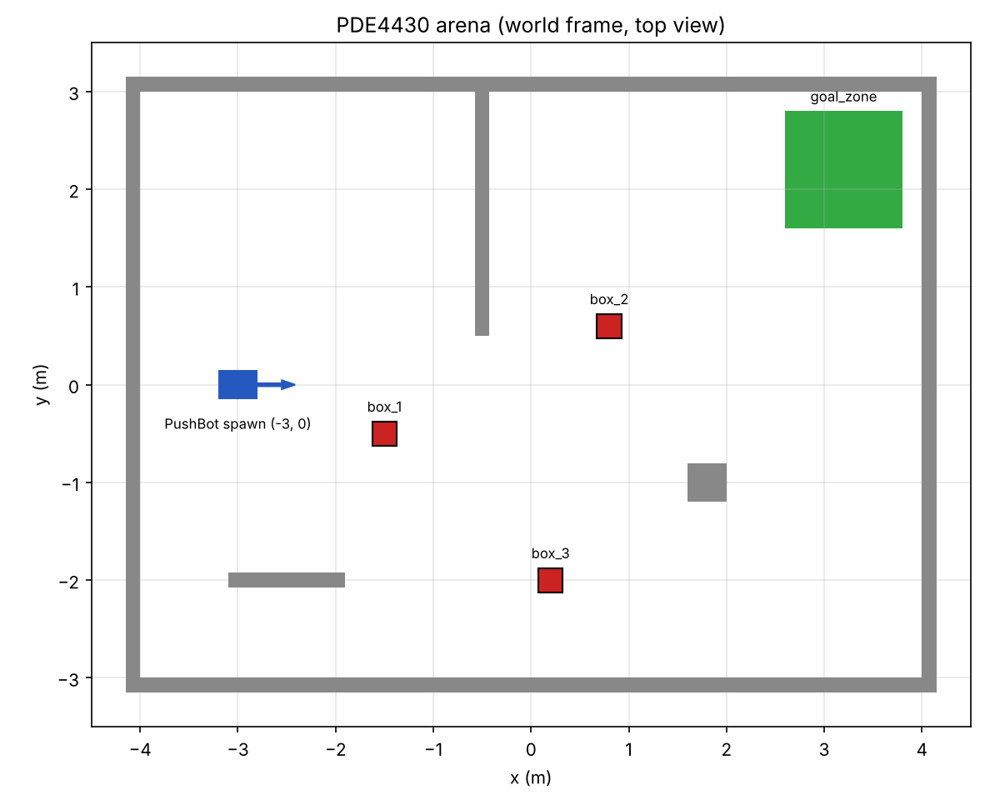

# PDE4430 PushBot

Course repository for the Gazebo block of **PDE4430 Mobile Robotics** (MSc Robotics, Middlesex University Dubai).

Over three sessions you will build a differential-drive robot in simulation, map an arena, navigate it autonomously, and finally push boxes into a goal zone.

**Stack:** ROS 2 Jazzy, Gazebo Harmonic, Ubuntu 24.04.



## Packages

| Package | What it contains | Session |
|---|---|---|
| `pushbot_description` | Robot model (URDF/xacro), ros2_control hardware block, LiDAR, RViz viewer | 1 |
| `pushbot_control` | ros2_control controller config (diff drive, joint states; your jaws) | 1 |
| `pushbot_gazebo` | Arena world, launch file (spawn + controllers), ROS–Gazebo bridge config | 1 |
| `pushbot_navigation` | SLAM config (Session 1 home task), Nav2 config (Session 2) | 1–2 |
| `pushbot_tasks` | Object detection and pushing nodes | 3 (added later) |

## Setup (once)

```bash
# ROS 2 Jazzy and Gazebo Harmonic packages
sudo apt update
sudo apt install ros-jazzy-desktop ros-jazzy-ros-gz ros-jazzy-xacro \
  ros-jazzy-joint-state-publisher-gui ros-jazzy-teleop-twist-keyboard \
  ros-jazzy-ros2-control ros-jazzy-ros2-controllers ros-jazzy-gz-ros2-control \
  ros-jazzy-slam-toolbox ros-jazzy-navigation2 ros-jazzy-nav2-bringup

# Workspace
mkdir -p ~/pde4430_ws/src
cd ~/pde4430_ws/src
git clone https://github.com/sameerkishore/pde4430-pushbot.git pde4430_pushbot

# Build
cd ~/pde4430_ws
source /opt/ros/jazzy/setup.bash
colcon build --symlink-install
source install/setup.bash
```

Add the two `source` lines to your `~/.bashrc` so every new terminal is ready:

```bash
echo "source /opt/ros/jazzy/setup.bash" >> ~/.bashrc
echo "source ~/pde4430_ws/install/setup.bash" >> ~/.bashrc
```

## Quick start

```bash
# View the robot on its own (no physics)
ros2 launch pushbot_description display.launch.py

# Full simulation: Gazebo + controllers + RViz + bridge
ros2 launch pushbot_gazebo sim.launch.py

# Same, in a virtual machine (VMware, Parallels, UTM) if Gazebo flickers
ros2 launch pushbot_gazebo sim.launch.py render_engine:=ogre

# Drive it (second terminal). The controller expects TwistStamped, hence stamped:=true
ros2 run teleop_twist_keyboard teleop_twist_keyboard --ros-args -p stamped:=true

# Check the controllers
ros2 control list_controllers

# Map the arena (third terminal, with the simulation running)
ros2 launch pushbot_navigation slam.launch.py
```

## Checkpoints

Each session has git tags so you can catch up if you fall behind:

| Tag | State |
|---|---|
| `s1-start` | Base robot, arena, bridge and teleop working |
| `s1-home-done` | Jaws and jaw controller added (released after Session 1's deadline) |

To start from a checkpoint without losing your own work:

```bash
git stash            # put your changes aside
git checkout s1-start
```

## Topic and frame reference

| ROS topic | Type | Direction | Source |
|---|---|---|---|
| `/cmd_vel` | `geometry_msgs/TwistStamped` | ROS | teleop, Nav2 → `diff_drive_controller` |
| `/odom` | `nav_msgs/Odometry` | ROS | `diff_drive_controller` |
| `/tf` | `tf2_msgs/TFMessage` | ROS | `diff_drive_controller` (`odom → base_footprint`), `robot_state_publisher` |
| `/joint_states` | `sensor_msgs/JointState` | ROS | `joint_state_broadcaster` |
| `/scan` | `sensor_msgs/LaserScan` | Gazebo → ROS (bridge) | gpu_lidar sensor |
| `/clock` | `rosgraph_msgs/Clock` | Gazebo → ROS (bridge) | simulation time |

Driving goes through **ros2_control**: the `controller_manager` runs inside Gazebo (the `gz_ros2_control` plugin), and the launch file starts `joint_state_broadcaster` and `diff_drive_controller`. Only the clock and sensors cross the bridge.

TF tree: `map → odom → base_footprint → base_link → {chassis_link → lidar_link, left_wheel_link, right_wheel_link, caster_link}`. The `map → odom` link only exists once SLAM or localisation is running.

## Regenerating the world

`pushbot_gazebo/worlds/arena.sdf` is generated by `tools/gen_world.py`. Edit the script and run:

```bash
python3 tools/gen_world.py pushbot_gazebo/worlds/arena.sdf
```
